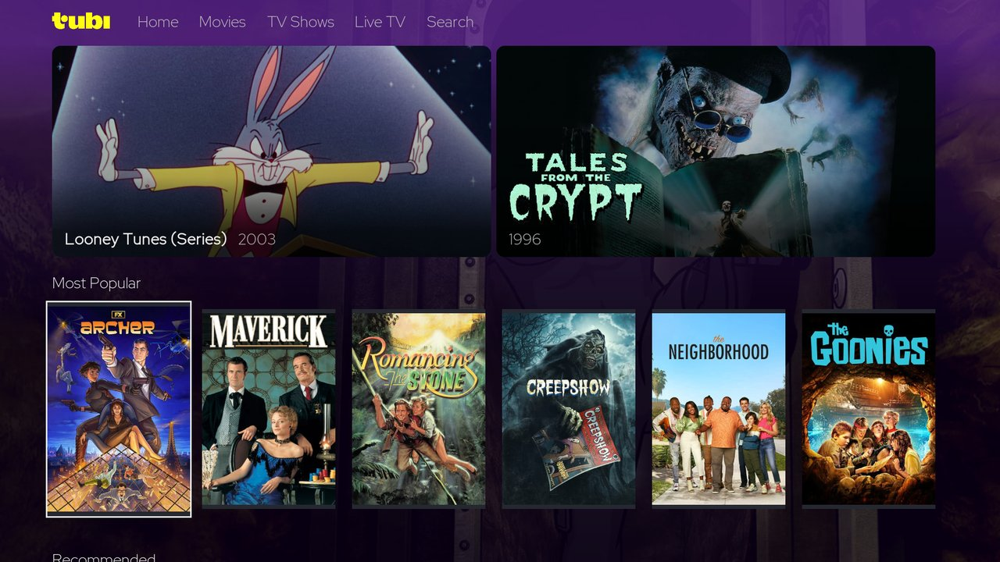
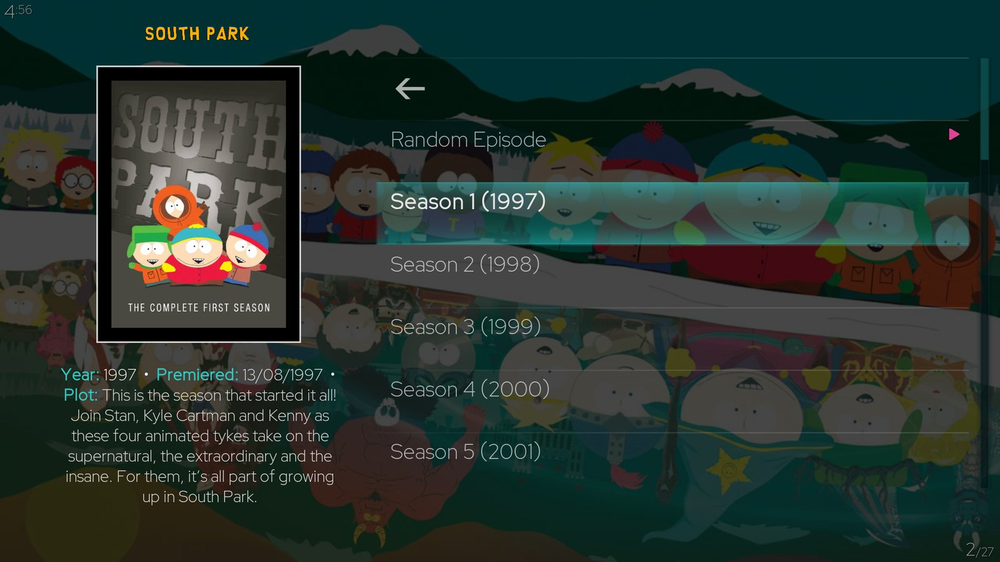

# Kodi Allen Repository

**Community add-ons for streaming, Blu-ray playback and a richer Kodi library.**

Discover TubiTV and ParkStream, play disc playlists with MPLS STRM Player, manage library
artwork, and customise Kodi with Aeon Tajo Tweaked. This repository distributes original tools and
maintained community forks, with Kodi 21 (Omega) as its main target.

**[Download repository installer](https://raw.githubusercontent.com/Kodi-Allen/kodi-repo/main/repository.kodiallen/repository.kodiallen-1.0.1.zip)**
 · [Installation](#installation) · [Add-ons](#available-add-ons) · [Screenshots](#a-look-inside)
 · [Help and feedback](#help-and-feedback)

## Installation

Install the repository once, then choose your add-ons inside Kodi. The repository supplies
updates through Kodi's normal add-on update system.

1. Download **[`repository.kodiallen-1.0.1.zip`](https://raw.githubusercontent.com/Kodi-Allen/kodi-repo/main/repository.kodiallen/repository.kodiallen-1.0.1.zip)**
   and save it somewhere Kodi can access, such as a local folder, USB drive or network share.
2. In Kodi, open **Settings → System → Add-ons**, enable **Unknown sources**, and confirm
   Kodi's warning. This allows installation from community repositories.
3. Open **Settings → Add-ons → Install from zip file**, select the downloaded ZIP, and
   wait for the installation confirmation.
4. Choose **Install from repository → Kodi Allen Repository** and open the appropriate
   category from the table below. Select an add-on and choose **Install**.

Use the **repository installer ZIP** above. GitHub's **Code → Download ZIP** contains the
source tree and cannot be installed as a Kodi add-on.

Already using repository version 1.0.0? Install version 1.0.1 over it if Kodi has not updated it
yet. Version 1.0.1 includes the additional release feed used to distribute Aeon Tajo.

## Available add-ons

Versions below match the repository's published add-on feeds.

| Add-on | What it does | Version | Kodi category |
|---|---|---|---|
| **[TubiTV](plugin.video.tubitv/README.md)** | Browse free, ad-supported films, series and live channels, with its own interface, library export and optional account features. | `2026.10.13.1` | Video add-ons |
| **[ParkStream](docs/parkstream/README.md)** | Browse South Park seasons and episodes from the official regional websites, with artwork, descriptions and a random episode option. | `1.0.2+matrix.1` | Video add-ons |
| **[MPLS STRM Player](plugin.video.mpls.strm.player)** | Play Blu-ray/UHD MPLS playlists from `.strm` files and create STRM files using thediscdb.com. | `4.1.0` | Video add-ons |
| **[Artwork Beef](script.artwork.beef)** | Download and manage extra artwork for movies, TV shows and music. This distribution includes Python 3 and Kodi Omega fixes. | `0.28.10` | Program add-ons |
| **[MyMovies Back Artwork Copy](script.mymovies.backcopy/README.md)** | Copy `mymovies-back.jpg` to `back.jpg` in your video library folders, manually or on a schedule. | `1.3.0` | Program add-ons |
| **[Aeon Tajo Tweaked](https://github.com/Kodi-Allen/skin.aeon.tajo-tweaked)** | Restores the classic Aeon Tajo Leia-style horizontal home menu and bold typography on Kodi 21 Omega, with maintained Live TV/PVR fixes. | `1.0.1` | Look and feel → Skin |
| **[Aeon Tajo (original ID)](https://github.com/Kodi-Allen/kodi-repo/releases/tag/skin.aeon.tajo)** | Earlier Aeon Tajo package by manfeed, retained separately for existing installations. | `7.7.4` | Look and feel → Skin |

The repository add-on itself is **Kodi Allen Repository `1.0.1`**.

### Compatibility and availability

- **Kodi 21 (Omega)** is the main target. ParkStream is documented as tested on Kodi 21.1;
  TubiTV's interface is tested on Kodi 21. Check each add-on's documentation for its requirements.
- **Kodi 19, 20 and 22:** compatibility varies by add-on. A version being accepted by Kodi does
  not mean it has been tested. See the [branch notes](BRANCHES.md) for the separate version feeds.
- **TubiTV** is unofficial. Tubi's country availability and regional catalogue still apply.
  Encrypted titles require a working Widevine CDM for InputStream Adaptive; see the
  [TubiTV requirements](plugin.video.tubitv/README.md#requirements-and-installation).
- **ParkStream** is unofficial. Episode availability and audio language depend on the official
  regional site. See its [known limitations](docs/parkstream/README.md#known-limitations).

## A look inside

These screenshots show the published add-ons. Select an image to open the full version or its documentation.

| Aeon Tajo Tweaked — classic Leia home menu | Aeon Tajo Tweaked — Live TV home menu |
|---|---|
| [](https://github.com/Kodi-Allen/skin.aeon.tajo-tweaked#screenshots-from-the-maintained-kodi-installation) | [](https://github.com/Kodi-Allen/skin.aeon.tajo-tweaked#screenshots-from-the-maintained-kodi-installation) |

| TubiTV — Home | ParkStream — Seasons |
|---|---|
| [](plugin.video.tubitv/resources/screenshots/home.jpg) | [](docs/parkstream/screenshots/parkstream-kodi-season-list.jpg) |
| [Features, settings and more screenshots](plugin.video.tubitv/README.md) | [Installation, settings and more screenshots](docs/parkstream/README.md) |

ParkStream's screenshots show Kodi 21.1 with the Aeon Tajo skin. Its appearance changes with
your Kodi skin; TubiTV provides its own interface.

## Help and feedback

- **Installation or repository problem:** open an
  [issue in kodi-repo](https://github.com/Kodi-Allen/kodi-repo/issues).
- **ParkStream problem:** check the
  [troubleshooting guide](docs/parkstream/README.md#troubleshooting), then use
  [ParkStream issues](https://github.com/Kodi-Allen/plugin.video.parkstream/issues).
- **TubiTV problem:** read the [TubiTV documentation](plugin.video.tubitv/README.md), then
  [report it here](https://github.com/Kodi-Allen/kodi-repo/issues).
- **General Kodi help:** visit the [Kodi community forum](https://forum.kodi.tv/).

For a useful report, include the add-on name and version, Kodi version, operating system,
what you expected, what happened, and steps to reproduce it. Remove passwords, tokens and
other private information from any logs you share. English and German reports are welcome.

## For contributors and maintainers

The root of this repository is a distribution feed. Some add-ons are developed here; others
are maintained in separate repositories. ParkStream's source is
[Kodi-Allen/plugin.video.parkstream](https://github.com/Kodi-Allen/plugin.video.parkstream).
Keep the original authors' credits and licenses when contributing to a community fork.

<details>
<summary>Repository layout and publishing workflow</summary>

```text
kodi-repo/
├── repository.kodiallen/       # Repository installer and metadata
├── plugin.video.*/            # Video add-ons and their versioned ZIP files
├── script.*/                  # Library and artwork tools with ZIP files
├── docs/parkstream/           # User documentation and Kodi screenshots
├── skin.aeon.tajo/resources/  # Earlier skin package artwork
├── skin.aeon.tajo.tweaked/    # Tweaked skin artwork; ZIP is in Releases
├── addons.xml                 # Main add-on feed
├── addons.xml.md5             # Main feed checksum
├── addons-releases.xml        # Feed for add-ons hosted in GitHub Releases
├── addons-releases.xml.md5    # Release feed checksum
└── tools/generate_repo.py     # Main feed and ZIP generator
```

To add or update an add-on:

1. Add its folder at the repository root with a valid `addon.xml` and a unique add-on ID.
   Include the appropriate license, original credits, artwork and changelog.
2. Make the changes, increase the version in `addon.xml`, and update the changelog.
3. Run the generator **from the repository root**:

   ```bash
   python3 tools/generate_repo.py
   ```

   On Windows, use `python .\tools\generate_repo.py`; set `PYTHONIOENCODING=utf-8` if your
   terminal cannot display the generator's status symbols.
4. Review the changed source, generated versioned ZIPs, `addons.xml` and its checksum before
   committing. The generator scans the current directory; running it from `tools/` will not
   find the add-ons.
5. For add-ons distributed through GitHub Releases, maintain `addons-releases.xml`, its
   checksum and the release assets separately. The generator does not update this second feed.

See [Kodi version branches](BRANCHES.md) before publishing to `kodi-21` or `kodi-22`, and the
[quick-start guide](QUICKSTART.md) for installation and repository maintenance.

</details>

## Credits and licenses

- **TubiTV:** based on the add-on by [Lunatixz](https://github.com/Lunatixz), with contributions
  credited to Lunatixz, Breezyslasher and Kodi Allen in its metadata; uses t1m Library Routines
  by [t1m](https://github.com/learningit). See its [credits and license](plugin.video.tubitv/README.md#credits).
- **ParkStream:** independently maintained fork of
  [plugin.video.southpark_unofficial](https://github.com/wargio/plugin.video.southpark_unofficial)
  by Giovanni Dante Grazioli (wargio). See its
  [full credits and license](docs/parkstream/README.md#credits-license-and-disclaimer).
- **Artwork Beef:** based on [rmrector/script.artwork.beef](https://github.com/rmrector/script.artwork.beef)
  by rmrector; see [LICENSE.txt](script.artwork.beef/LICENSE.txt).
- **Aeon Tajo Tweaked:** independently maintained by Kodi Allen, based on
  [Aeon Tajo by manfeed](https://github.com/manfeed/skin.aeon.tajo) and licensed under
  CC BY-NC-SA 4.0 as declared in the release feed.
- **Aeon Tajo (original ID):** by [manfeed](https://github.com/manfeed/skin.aeon.tajo), retained
  as a separate legacy package.
- **Repository framework:** inspired by the Kodi community.
- **Maintainer:** Kodi Allen.

Each add-on has its own license. Refer to its `addon.xml`, license file and documentation;
also preserve any license notices in individual source files. No separate root license file
is included for the repository framework, and there is no single license covering every
add-on and all included artwork.

## Disclaimer

These add-ons are community ports and tools for Kodi Omega. Use at your own risk.
This is an independent community repository, not an official Kodi repository.

ParkStream is not affiliated with or endorsed by South Park Studios, Comedy Central or
Paramount. South Park titles, characters and artwork belong to their respective owners.
TubiTV is not affiliated with or endorsed by Tubi. Content availability is controlled by the
respective service and your location. Check your local laws before use.
