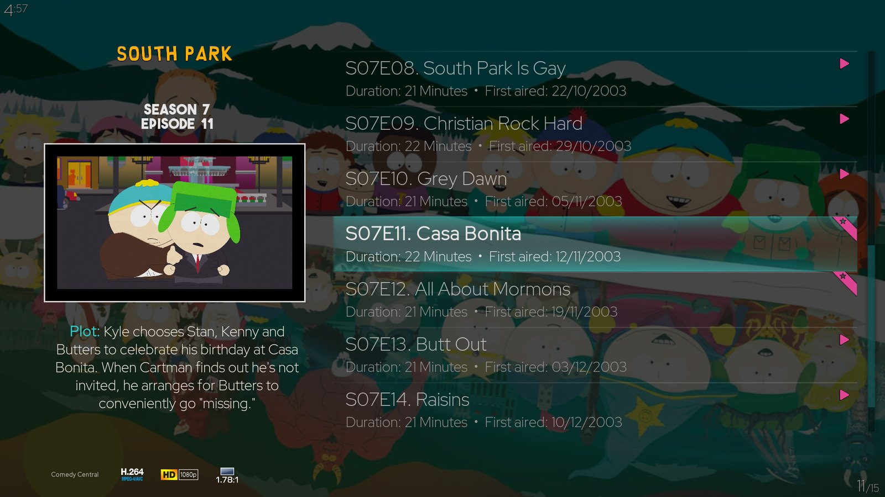
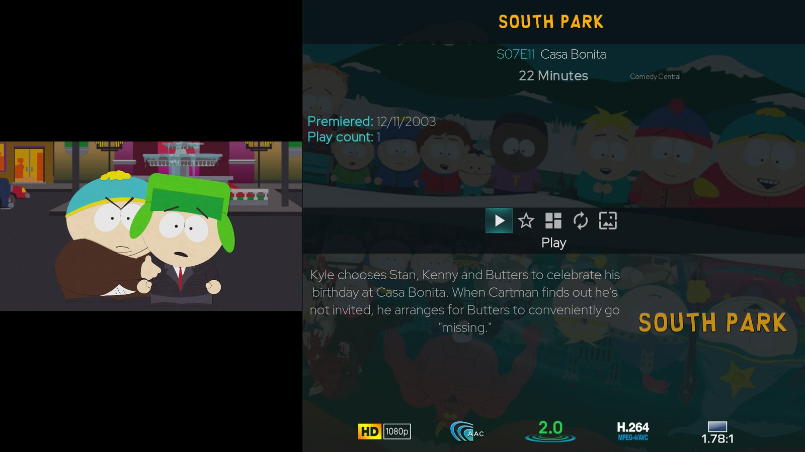
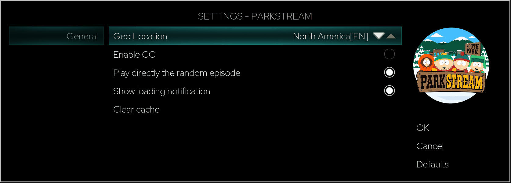
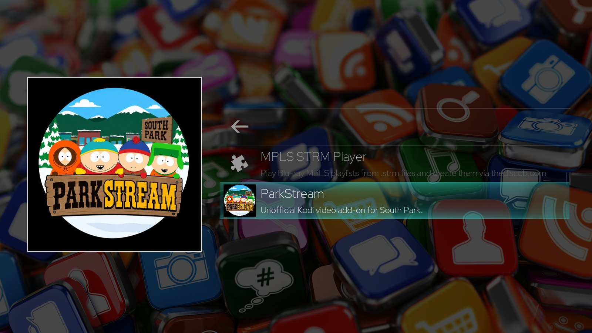

# ParkStream – South Park Kodi Add-on

ParkStream is an unofficial Kodi video add-on for watching South Park episodes from the official
South Park websites. Browse all seasons with season covers, episode stills and descriptions, pick a
random episode, and choose the regional site that matches your audio language.

ParkStream is independently maintained. It is a fork of
[plugin.video.southpark_unofficial](https://github.com/wargio/plugin.video.southpark_unofficial)
by Giovanni Dante Grazioli (wargio) and is distributed through the
[Kodi Allen Repository](../../README.md).

| | |
|---|---|
| Add-on ID | `plugin.video.parkstream` |
| Current version | 1.0.2+matrix.1 |
| Kodi version | Kodi 21 (Omega) |
| Category | Video add-ons |
| License | GPL-2.0-only |
| Source code | [Kodi-Allen/plugin.video.parkstream](https://github.com/Kodi-Allen/plugin.video.parkstream) |

## Contents

- [Features](#features)
- [Screenshots](#screenshots)
- [Compatibility](#compatibility)
- [Installation](#installation)
- [Configuration and usage](#configuration-and-usage)
- [Known limitations](#known-limitations)
- [Troubleshooting](#troubleshooting)
- [Data sources](#data-sources)
- [Credits, license and disclaimer](#credits-license-and-disclaimer)

## Features

- **Browse South Park by season.** All 26 seasons are listed with a season cover, a season
  description and the year of the first broadcast.
- **Episode artwork and information.** Each episode shows its official still, plot, runtime and
  original air date.
- **Streams from the official South Park websites.** Episodes are played through Kodi's own
  video player; no additional add-ons are required.
- **Regional sites and audio language.** The *Geo Location* setting selects the official site and
  with it the audio and description language, for example *Germany* for German or
  *North America[EN]* for English.
- **Multiple audio tracks.** When an episode is delivered with more than one audio track, all
  tracks are available in Kodi's audio menu. Some English episodes, for example, also carry a
  Spanish track.
- **Season descriptions in several languages.** English, German and Spanish for all seasons,
  Portuguese for some; other languages fall back to English.
- **Random episode.** A *Random Episode* entry picks an episode for you and can start it directly.
- **Extended artwork for Kodi skins.** Fan art, clear logo, clear art, banner and season posters
  are provided for skins that display them.
- **Interface languages.** English, German, Italian, Portuguese (Brazil and Portugal), Spanish
  (Spain and Mexico) and Swedish.

## Screenshots

All screenshots were taken from ParkStream 1.0.2 running on Kodi 21.1 with the Aeon Tajo skin.
The appearance depends on the Kodi skin you use.

**Episode list with episode stills, runtimes and air dates**

**Episode information**

**Add-on settings**

## Compatibility

| Kodi version | Status |
|---|---|
| Kodi 21 (Omega) | Tested on a Vero 4K+ (OSMC) with Kodi 21.1 |
| Kodi 19 (Matrix), Kodi 20 (Nexus) | The add-on can be installed, but has not been tested |
| Kodi 22 | Not tested |

ParkStream is a pure Python add-on without platform-specific code. Only the Vero 4K+ has been
tested.

## Installation

### Recommended: Kodi Allen Repository

Installing through the repository gives you automatic updates.

1. Download the repository installer
   [`repository.kodiallen-1.0.1.zip`](https://github.com/Kodi-Allen/kodi-repo/raw/main/repository.kodiallen/repository.kodiallen-1.0.1.zip)
   and copy it to a location Kodi can open, for example a USB stick or a network share.
2. Allow add-ons from outside the official Kodi repository: open **Settings → System →
   Add-ons** and switch on **Unknown sources**. Confirm the warning with **Yes**.
3. Go back to **Settings → Add-ons**, choose **Install from zip file** and select
   `repository.kodiallen-1.0.1.zip`. Kodi reports when the repository has been installed.
4. Choose **Install from repository → Kodi Allen Repository → Video add-ons → ParkStream** and
   select **Install**.
5. Start ParkStream from **Add-ons → Video add-ons → ParkStream**.

### Alternative: manual ZIP installation

1. Download `plugin.video.parkstream-1.0.2+matrix.1.zip` from the
   [ParkStream 1.0.2 release](https://github.com/Kodi-Allen/plugin.video.parkstream/releases/tag/v1.0.2).
2. Switch on **Unknown sources** as described above.
3. Open **Settings → Add-ons → Install from zip file** and select the downloaded file.

A manually installed add-on is not updated automatically. Repeat these steps for a new version or
use the repository instead.

## Configuration and usage

Open ParkStream from the video add-ons. The first entries are **Random Episode** and the seasons;
select a season to see its episodes and select an episode to play it.

Open the settings from the context menu of ParkStream in the add-on list (**Settings**) or, in
skins that offer it, from the side menu while ParkStream is open.

| Setting | Effect |
|---|---|
| Geo Location | Selects the official regional South Park site and thereby the audio language, episode titles and descriptions. Default: *North America[EN]*. |
| Enable CC | Only applies to legacy streams. The current video service delivers no separate subtitles, so this setting has no effect at the moment. |
| Play directly the random episode | When switched on, *Random Episode* starts playback immediately. When switched off, the randomly chosen episode is shown first and can be started from there. |
| Show loading notification | Shows "Loading" with the episode title while an episode starts. On by default. |
| Clear cache | Deletes the locally cached episode lists; they are downloaded again on the next start. |

Confirm changes with **OK**. Closing the dialog with **Cancel** or *Back* discards them. Kodi does
not reload the list that is already on screen, so a new location becomes visible once you open a
folder or return to ParkStream.

### Locations

| Geo Location | Official site | Status |
|---|---|---|
| North America[EN] | southpark.de/en (English version of the German site) | Tested from Germany |
| Germany | southpark.de | Tested from Germany |
| Sweden | southparkstudios.nu | Streams resolve when tested from Germany; audio language not verified |
| Europe | southparkstudios.com | Streams resolve when tested from Germany; audio language not verified |
| North America[ES] | southparkstudios.com | Not reachable from Germany; not tested |
| Brasil | southparkstudios.com.br | Not reachable from Germany; not tested |
| Latin America[ES] | southpark.lat | Not reachable from Germany; not tested |

## Known limitations

- **Geographic availability.** The official sites decide which content they serve to your
  location. A site may redirect or refuse requests from other countries.
- **Regional catalogues.** Episode lists differ between locations, and a few episodes are not
  offered in every language. The Spanish episode lists currently end with season 25.
- **Advertising.** The official streams contain inserted advertising breaks.
- **No subtitles.** The current video service does not provide subtitles to the add-on.
- **Start-up time.** An episode usually takes 10–15 seconds to start. On slow connections Kodi
  can time out while opening the stream.
- **Partially translated descriptions.** Season descriptions are not available in every
  language; missing translations fall back to English.

## Troubleshooting

| Problem | Solution |
|---|---|
| "It's not available, sorry" | The episode is not offered for the selected location, or the stream could not be resolved. Try again later or choose another *Geo Location*. |
| Wrong audio or description language | Check *Geo Location* and confirm the dialog with **OK**. Then open a season or return to ParkStream so that the list is reloaded. |
| Episode list is outdated | Run **Clear cache** in the settings and open ParkStream again. |
| Playback does not start | Wait up to 15 seconds, then try again. On slow connections the first attempt can time out. |
| Settings are not saved | Close the settings dialog with **OK**; **Cancel** and *Back* discard changes. |
| ParkStream is missing in the repository | Make sure **Unknown sources** is switched on and the Kodi Allen Repository is installed, then look under **Video add-ons**. |

## Data sources

- Episode lists: the `addon-data` branch of
  [wargio/plugin.video.southpark_unofficial](https://github.com/wargio/plugin.video.southpark_unofficial/tree/addon-data).
- Streams, episode stills, runtimes and the English and German season descriptions: the official
  South Park websites.
- Spanish and Portuguese season descriptions: [TheTVDB](https://thetvdb.com/series/south-park).

## Credits, license and disclaimer

- Original add-on *plugin.video.southpark_unofficial* by Giovanni Dante Grazioli (wargio).
- Contributors to the original add-on: anxdpanic, eldergabriel, mvn23, Niema Moshiri, serajr.
- ParkStream is maintained by Kodi-Allen.

ParkStream is free software, licensed under the GNU General Public License, version 2
([GPL-2.0-only](https://github.com/Kodi-Allen/plugin.video.parkstream/blob/master/LICENSE.txt)).
The license applies to the source code. It does not cover the South Park artwork included for
identification (season covers, logos, fan art), which remains the property of its owners.

ParkStream is unofficial and not affiliated with or endorsed by South Park Studios, Comedy
Central or Paramount. South Park and all related titles, characters and artwork are trademarks
and copyrights of their respective owners. Check your local laws before use.

Problems and suggestions:
[ParkStream issues](https://github.com/Kodi-Allen/plugin.video.parkstream/issues).
