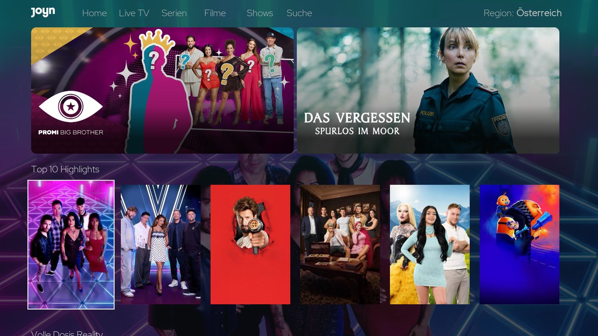
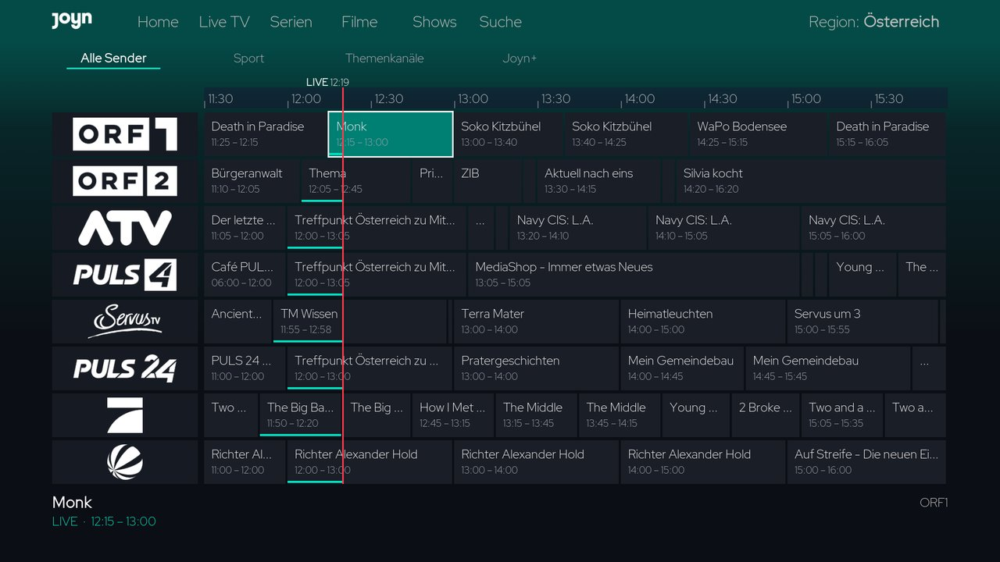
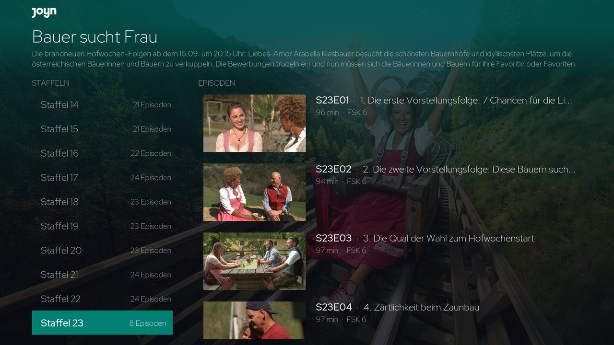

# Joyn for Kodi

An unofficial Kodi video add-on for the free offer of **Joyn Austria, Germany
and Switzerland**, with its own full-screen interface: Home, Live TV, Series,
Movies, Shows and Search, and one region selector for AT, DE and CH.

Not affiliated with or endorsed by Joyn. Joyn decides per title, channel and
connection where something may play; the add-on shows Joyn's answer and does
not work around it.

## Features

- **Home** with two featured cards, a hero background and Joyn's own rows
- **Live TV guide** from Joyn's programme data: channel logos, a half-hour
  timeline, the current time and programme progress
- **Series, Movies, Shows**: Joyn's own landing pages and rows for each region
- **Series pages** with seasons and episodes; the newest free season opens first
- **Search** within the selected region
- **Regions**: Austria, Germany and Switzerland, each with its own catalogue,
  session, cache and network route; switching never touches another region
- **Joyn+** titles and channels stay visible and are marked `[Joyn+]`
- **Network route per region**: direct, or custom with an HTTP CONNECT proxy
  for the add-on's API calls and a media relay for Kodi's manifest, segment,
  subtitle and licence requests. Kodi's global proxy is never changed; a
  custom route that is incomplete or down fails closed.
- **Kodi TV (optional)**: live channels for IPTV Manager, off by default

| Live TV | Series |
|---|---|
|  |  |

## Requirements

- Kodi 21 (Omega). Developed and tested on Kodi 21.1.
- `inputstream.adaptive` and a working **Widevine CDM** for that device.
  Joyn streams are MPEG-DASH with Widevine (CENC); decryption is done only by
  the device's own CDM. Install the CDM with InputStream Helper where needed.
- `script.module.requests`
- For Kodi TV: `service.iptv.manager` with IPTV Simple Client

## Installation

From the Kodi Allen repository: *Add-ons → Install from repository →
Kodi Allen Repository → Video add-ons → Joyn*. Or install the release ZIP
with *Install from zip file*.

Open **Joyn** from *Videos → Add-ons*. The region selector is at the right of
the navbar.

## Regions and connections

| Region | Catalogue | Playback |
|---|---|---|
| Austria | from anywhere | from an Austrian connection |
| Germany | from anywhere | from a German connection |
| Switzerland | from anywhere | from a Swiss connection |

Joyn issues the playback right per connection. It refuses addresses outside
the region and known VPN addresses. For a region you are not in, set up a
custom route under *Settings → Germany* or *Switzerland* that uses a
connection Joyn accepts for that region, and check it with *Connection test*.
The relay for custom routes is in [`deploy/joyn-relay`](https://github.com/Kodi-Allen/kodi-repo/tree/main/deploy/joyn-relay).

## Account

The free offer plays without an account for a while; Joyn then refuses
further playback on that device until you sign in. A free Joyn account is
enough. Sign in per region under *Settings → Austria / Germany /
Switzerland → Sign in to Joyn*:

- Joyn's own web sign-in is used; the add-on keeps only the tokens (in the
  region's profile folder, readable by the Kodi user only), never the
  password, and renews them on its own.
- Each region has its own sign-in; *Sign out* returns that region to
  anonymous use.
- If Joyn needs more details or consents for a region, sign in once on that
  region's website (joyn.at, joyn.de, joyn.ch) and complete the profile.
- Two-factor sign-in is not supported.

## Kodi TV (IPTV Manager)

*Settings → Kodi TV → Add live channels to Kodi TV* exports the live channels
of the selected regions to IPTV Manager:

- one group per region (`Joyn AT`, `Joyn DE`, `Joyn CH`)
- fixed channel numbers kept in the add-on's profile: AT 6001–6499,
  DE 6501–6999, CH 7001–7499; a number another source already uses is
  never handed out
- programme data as Joyn sends it
- playlist entries are plugin routes; no short-lived token is ever stored
- if Joyn cannot be reached, the last line-up is served again
- *Show channels Kodi already has* lists channels other sources already
  provide; *Leave out channels Kodi already has* skips them (matched by name)

## Licence

GPL-3.0-or-later, see [LICENSE.txt](LICENSE.txt).

The interface is derived from the Kodi Allen Tubi add-on. The Joyn API
details were cross-checked against two open Joyn projects:
[plugin.video.joyn](https://github.com/Maven85/plugin.video.joyn) by knaerzche
and Maven85, and
[script.service.ultimate](https://github.com/nirvana-7777/script.service.ultimate)
by nirvana-7777. Both are GPL-2.0; no code was taken over from them.
