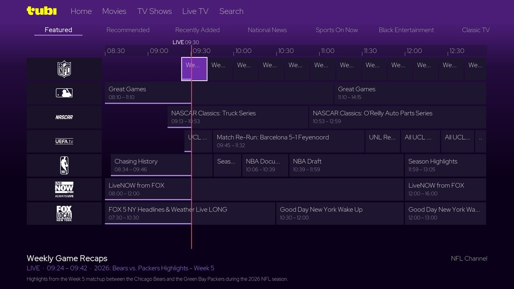
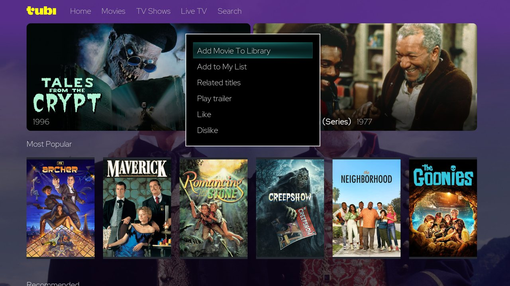

# TubiTV for Kodi

Browse and watch [Tubi](https://tubitv.com/) — free, ad-supported films, TV
shows and live channels — from inside Kodi, in an interface laid out like
Tubi's own.

This is an unofficial add-on, not affiliated with Tubi. It is a fork of
[Lunatixz's](https://github.com/Lunatixz) `plugin.video.tubitv`, kept here so
the sign-in can be maintained as Tubi changes its API.

## Features

- Home, Movies, TV Shows, Search and a Live TV guide in the add-on's own
  interface
- Series with their seasons and episodes, cast, plot and artwork
- A programme guide for Tubi's live channels, from Tubi's own guide data
- Title actions in the context menu: add to the Kodi library, related
  titles, trailers, and — signed in — My List, likes and dislikes
- Resume from where Tubi's watch history says you stopped
- Optional Tubi account sign-in
- Live channels in Kodi's TV guide through IPTV Manager
- Add a film or a whole show to the Kodi library as `.strm` files
- Kids mode, and Tubi's own English, Spanish or French metadata
- PseudoTV Live recommendation service
- Direct or add-on-local custom routing without changing Kodi's global proxy

## Availability

Tubi streams only in the countries it serves, and its catalogue differs from
one country to the next. Tubi decides from where a connection comes; titles
and channels that it does not offer in your region are not available here
either.

## Requirements and installation

- Kodi 21 (Omega) is the version the add-on is tested on. It declares Kodi 19
  and later and keeps compatibility code for Kodi 19 and 20, but the add-on's
  interface has only been tested on Kodi 21.
- Encrypted titles need Widevine; see [Widevine](#widevine).

Install the **Kodi Allen Repository** (see the repository's main README), then
in Kodi: Settings → Add-ons → Install from repository → Kodi Allen Repository →
Video add-ons → TubiTV. Kodi installs the dependencies — t1m Library Routines,
Requests and InputStream Adaptive — from the official Kodi repository.
InputStream Helper is optional.

## The interface

Opening the add-on shows a short loading screen, then the add-on's Home. A
navigation bar — Home, Movies, TV Shows, Live TV, Search — sits on every page.
Back returns to the page before; Back on Home leaves the add-on.

- **Home**: two featured titles at a time that change every few seconds, Most
  Popular, and three more rows from Tubi's home screen.
- **Movies** and **TV Shows**: Tubi's own Movies and TV Shows pages as rows of
  posters, in Tubi's order.
- **Series**: the seasons on the left, the episodes of the chosen season on
  the right.
- **Search**: type a title; films and series appear as a grid of posters.
- **Live TV**: a programme guide built from Tubi's own guide data — Tubi's
  channel categories, channel logos, programmes on a timeline in half-hour
  steps, a line marking the current time and how far the current programme
  has got. Choose a programme that is on now to watch the channel; programmes
  later in the day show their details.




### Context menu

On a film or series, the context menu (the Menu or C key, or a right click)
offers:

| Action | Shown for |
|---|---|
| Add Movie To Library / Add Show To Library | films / series |
| Related titles | films and series; opens a page of related titles |
| Play trailer | titles Tubi has a trailer for |
| Add to My List / Remove from My List | signed in |
| Remove from Continue Watching | signed in, titles in your watch history |
| Like / Dislike | signed in; choosing it again clears the rating |

Episodes and live channels have no context menu.



### Resume

If Tubi's watch history holds a position for a film or episode, selecting it
offers **Resume from …** or **Play from beginning**. Signed in, with **Tell
Tubi where you stopped watching** on, the add-on reports the position when
playback stops (see [Resume](#resume-1)).

## Known limitations

- Rows show the first page of each Tubi row (up to 50 titles), and Search
  shows up to 120 results. There is no "show more" yet; Search finds titles
  beyond those.
- Home has no Continue Watching or My List row, and My List has no page of
  its own. Titles are added to and removed from My List in the context menu.
- The interface uses the active skin's fonts. Under skins other than the one
  it was designed with, text sizes differ slightly; under Estuary the series
  title appears in a smaller font.
- Kodi favourites and skin shortcuts that point to one of the add-on's folders
  (rather than to the add-on itself) still open that folder as a plain Kodi
  list.
- Encrypted 720p renditions need hardware DRM; see
  [Playback and DRM](#playback-and-drm).

## Folder listings

Behind the interface the add-on still provides its plain Kodi folders —
Tubi's category list, Home rows, series and seasons, channels, search. Kodi
favourites, the library `.strm` files, PseudoTV Live and other add-ons use
them, and the interface returns to them only if it cannot start. Category
folders page through every title.

## Network route, proxy and media relay

The add-on has its own **Direct / Custom** network route and never changes
Kodi's global proxy. In Custom mode its Python requests use the configured
HTTP CONNECT proxy. URLs handed to Kodi are independently wrapped for the
configured GeoTV media relay, because InputStream Adaptive has no reliable
per-stream proxy setting.

The relay uses short-lived HMAC capability URLs and rewrites every URL in an
HLS playlist and every media `BaseURL` in a Tubi DASH manifest. This keeps
manifests, child playlists, media byte ranges, subtitles, artwork, redirects
and legitimate Widevine licence POSTs on the same VPN exit.
Missing custom settings fail closed instead of silently leaking to the direct
connection. The matching Privado/Gluetun deployment is in
`deploy/geotv/README.md` in the Kodi Allen repository.

All Tubi HLS renditions, including clear streams, are handed to InputStream
Adaptive. The relay never forwards Kodi's byte-range probes for a manifest:
rewriting signed child URLs changes the body length, so a partial upstream
response and its old `Content-Range` would describe different bytes and cause
the player to stall or reach a false EOF.

## Which endpoints this uses

Tubi retired the `/oz` endpoints the addon used to browse with. Everything now
goes through the API the Tubi site itself uses, and every call authenticates
with a bearer token — the signed-in user token when there is one, the anonymous
device token otherwise:

| Purpose | Endpoint |
|---|---|
| Category list | `tensor-cdn…/api/v1/browse_list` |
| Category contents, paged | `tensor-cdn…/api/v7/containers/{id}` |
| Search | `search…/api/v3/search` |
| Seasons of a series | `content-cdn…/api/v3/series/{id}/episodes` |
| Title, metadata and streams | `content-cdn…/api/v3/content` |
| Linear channel line-up | `tensor-cdn…/api/v2/epg` |
| Live programme guide | `epg-cdn…/content/epg/programming` |
| Personalised home rows | `tensor-cdn…/api/v8/homescreen` |
| My List | `user-queue…/api/v2/queues` |
| Related titles | `autopilot-cdn…/api/v3/related` |
| Resume reporting | `lishi…/api/v2/view_history` |
| Saving and unsaving a title | `user-queue…/api/v2/queues` |
| Part-watched titles, and forgetting one | `lishi…/api/v2/view_history` |
| Liking and disliking | `account…/user/preferences/rate` |

## Playback and DRM

Tubi encrypts some titles and not others, so the addon handles both. It asks
for `hlsv6`, `hlsv3` and the Widevine stream, then prefers whichever clear
stream is on offer, choosing the highest resolution and H.264 over H.265 since
more devices can decode it.

`hlsv3` is in that list because some titles have no clear `hlsv6` at all —
their only unencrypted rendition is an `hlsv3` 480p sitting beside encrypted
720p ones. Tubi's own web player takes exactly that stream on those titles and
never requests a licence. Of the 404 non-live titles seen across the captures,
59 carry DRM, and 26 of those are of this shape; without `hlsv3` the only thing
left to pick for them was a 720p rendition no software CDM can play.

When only an encrypted stream is available, playback goes through
`inputstream.adaptive` with `com.widevine.alpha` and the title's own licence
server, which needs a working Widevine CDM on the device (see
[Widevine](#widevine)). The add-on prefers Tubi's DASH rendition for DRM
titles. Clear titles remain on HLS and play without DRM. The anonymous device
token is enough for encrypted playback too: a guest token was seen carrying a
Widevine licence through to a decoded picture on supported devices.

Across every capture taken, 70 titles carry DRM, and the HDCP grade tracks the
resolution rather than the title — without a single exception in 810
renditions:

| height | `hdcp_version` | renditions |
|---|---|---|
| 576 | `hdcp_disabled` | 303 |
| 720 | `hdcp_v1` | 726 |
| 1080 | `hdcp_v1` | 84 |

A software CDM — which is all a desktop, Flatpak or LibreELEC Kodi has —
cannot play the protected kind. Measured on Rush Hour with a software CDM,
which reports Widevine level 3, the 576p rendition plays and the
720p one does not. Kodi 22 with inputstream.adaptive 22.3.20 names the reason:

```
CurlFile::Open - https://license.adrise.tv/challenge?…&drm_token=…"hdcp":"v1"…
OnKeyStatusChangeNotify: KID b9a568f6…, status OUTPUT_NOT_ALLOWED
License update successful
KID b9a568f6… not found in DRM license
InitializeSession: Failed to initialize a DRM session for the stream
OpenStream - Unsupported stream 1001. Stream disabled.
```

The licence request succeeds. The key it returns is marked
`OUTPUT_NOT_ALLOWED`, so no usable key reaches the decoder. Kodi 21 with ISA
21.5.22 does the same in less obvious words — key status 3, `Single decrypt
failed, secure path only`, then `kNoKey` on every frame until the stream ends.
So the addon prefers the HDCP-free rendition by default.

Tubi issues both renditions of a title against the same licence session — the
same `external_id` — and the two tokens differ only in their output policy:
`hdcp: v1` with `analog_out: cgms_required` for 720p, against `hdcp: disabled`
with `analog_out: enabled` for 576p. `wv_security_level` and
`pr_security_level` are identical on both, so the HDCP grade is the only thing
separating the rendition that plays from the one that does not.

inputstream.adaptive's own **Ignore HDCP status** makes no difference: it
governs whether ISA filters renditions by HDCP itself, not whether the licence
server will issue a usable key.

Turn on **Allow HDCP protected streams** in the Playback settings if your device
has hardware DRM (many Android TV boxes and Shields do) and you would rather
have the higher quality rendition. It is a 720p-against-576p choice on the
titles that have no clear rendition, and changes nothing anywhere else, since a
clear stream is preferred before HDCP is considered at all.

The licence request is handed to inputstream.adaptive through `drm_legacy` on
version 21 and later, and through the older `license_type`/`license_key`
properties on builds that predate it — those are deprecated upstream but remain
the only ones Kodi 19 and 20 understand. Tubi's licence token is issued to its
web-client context, so the licence request keeps the API request's User-Agent
and supplies Tubi's Origin and Referer. The Widevine challenge and response are
still handed through unchanged.

## Widevine

DRM-protected Tubi titles need a working Widevine CDM that Kodi's
InputStream Adaptive can use. Clear titles and Live TV never need one.

- On platforms with native Widevine support, such as many Android devices,
  no extra configuration is normally needed.
- On Linux, Windows and macOS, InputStream Helper is the usual way to install
  Widevine for InputStream Adaptive.
- Some older Linux, OSMC and ARM-based systems need InputStream Helper or a
  manually maintained, compatible Widevine CDM setup.

The add-on does not require or check a particular Widevine path, version or
InputStream Helper layout. It hands encrypted titles to Kodi and InputStream
Adaptive, and if they can use the installed CDM, playback goes ahead. Older
or custom Linux installations can therefore work even when their Widevine
setup differs from the standard InputStream Helper layout. Whether a given
device can decode a given title is decided by Kodi, InputStream Adaptive, the
CDM and Tubi's licence server, not by the add-on.

The one case the add-on refuses is a CDM that would crash Kodi: a library that
uses packed `DT_RELR` relocations on a system whose dynamic loader cannot
process them. It is detected from the file without loading it, and you get a
message instead of a crash.

### Legacy Linux and OSMC

Older Linux userlands, OSMC devices or non-standard ARM configurations may need
a compatible Widevine CDM supplied by hand. Installing it is outside this
add-on, which only delegates DRM playback to Kodi and InputStream Adaptive.
Not every legacy system can play every encrypted title.

## DRM diagnostics

Enable **Detailed DRM diagnostics** under Playback for an opt-in report in
`kodi.log`. It includes the OS, kernel machine, userspace bitness, Kodi, ISA and
InputStream Helper versions, CDM path/version/ELF architecture, RELR support,
every Tubi resource and HDCP grade, DASH representations, Widevine
`ContentProtection`, whether PSSH is present, and the ISA property names used.
URL query values are replaced with `MASKED`; bearer tokens, licence challenges,
licences, PSSH bodies, proxy passwords and relay signing keys are never logged.

The API can supply different manifests and licence policies for different
nominal resolutions. ISA can adapt among representations inside the selected
MPD, but it cannot fall back from a rejected HDCP-protected Tubi resource to a
different HDCP-free manifest. The Playback setting therefore remains an
explicit policy choice rather than assuming that every L3 device is limited to
576p.

## Live TV and IPTV Manager

Tubi carries well over a hundred linear channels. They are unencrypted plain
HLS and need no CDM. The add-on's **Live TV** page shows them in its own
guide (see [The interface](#the-interface)).

The addon also implements the
[IPTV Manager](https://github.com/add-ons/service.iptv.manager/wiki/Integration)
integration, which puts those channels into Kodi's own TV section with a
programme guide roughly two days deep. Install IPTV Manager and it will pick
this addon up on its own — the **IPTV Manager** setting is on by default and can
be switched off if you would rather keep the channels inside the addon.

The channel line-up is served as JSON-STREAMS and the guide as JSON-EPG, both
written back over the callback socket IPTV Manager supplies.

- **Channel numbers** stay put. Tubi has none of its own, so the addon keeps
  them in `iptv.json` in its profile: the first line-up is numbered in Tubi's
  order, a new channel goes on the end, and a channel Tubi drops keeps its
  number reserved. Turn on *Settings → PVR & Live TV → General → Use channel
  numbers from backend* so Kodi shows them. Deleting `iptv.json` numbers the
  channels afresh.
- **Groups**: a channel is listed in every Tubi group it belongs to.
- **Guide depth**: Tubi's guide always ends on a UTC midnight, the end of the
  day after tomorrow, so it reaches 48 to 72 hours ahead.
- **Logos and guide images** are Tubi's own public image URLs, never relay
  URLs, because IPTV Manager and IPTV Simple keep them for hours or days and
  a signed relay URL would expire in between.
- **A failed refresh** does not empty the channel list. Live calls retry a
  lost connection, and if Tubi still cannot be reached the last line-up is
  served again. IPTV Manager would otherwise write an empty playlist, and IPTV
  Simple would remove every channel. Programme data comes from Tubi on each
  refresh; if Tubi cannot be reached at all the guide has no programmes until
  the next successful refresh.

On Kodi 20 and later, IPTV Manager's *Configure IPTV Simple automatically*
writes IPTV Simple's legacy add-on settings, not its per-instance settings.
Configure an IPTV Simple instance yourself instead: a local M3U at
`userdata/addon_data/service.iptv.manager/playlist.m3u8` and a local XMLTV at
`.../epg.xml`.

The callback socket is opened before the document is built. IPTV Manager gives
an addon ten seconds to call back and then waits as long as the connection
stays open, and building the guide takes one request per batch of channels —
comfortably more than ten seconds — so connecting first is what keeps the guide
from arriving empty.

## Adding to the Kodi library

**Add Movie To Library** and **Add Show To Library** in a title's context
menu write `.strm` files — one per film, one per episode — that play back
through this addon.

They go under this addon's own profile directory:

```
userdata/addon_data/plugin.video.tubitv/movies/<Title>/<Title>.strm
userdata/addon_data/plugin.video.tubitv/shows/<Series>/S01E01  <Title>.strm
```

The path is logged each time, at debug level, so a debug log says where a title went.

Kodi does not show them until that folder is added as a video source —
Settings → Media → Library → Videos → Add videos, pointed at `movies` as
Movies and `shows` as TV shows. Until then the export looks like it did
nothing: the scan it kicks off finds no source covering the folder and
finishes in a millisecond.

t1mlib writes these under `script.module.t1mlib`'s profile instead — a folder
belonging to a dependency, which nobody would think to add as a source. This
addon overrides that so its own exports are somewhere that makes sense.

## Resume

With **Tell Tubi where you stopped watching** on and an account signed in, the
addon reports your position when playback stops, so Continue Watching here and
in Tubi's own apps agree. A background service does the reporting: by the time
playback stops the plugin process that resolved the stream is long gone, so it
leaves what is playing in a window property for the service to pick up.

A film reports as itself. An episode reports as itself too, with its series
named alongside as a `parent_id` — a string, where the content id is a number.
Trailers report nothing.

The same history is read back when a page is loaded. If it holds a position
for a film or episode, selecting the title offers **Resume from …** or
**Play from beginning**, as Kodi does for its own bookmarks. Removing a title
from Continue Watching keys on the history entry's own id rather than the
title's, so the history is read first — the same shape as unsaving from My
List.

## Language

Tubi localises its category names and descriptions from the `Accept-Language`
it is asked with; nothing else about a request changes. The **Language** setting
picks between the three it has been seen serving — `en-US`, `es-MX` and `fr-CA`.

## A note on ids

A series is identified by its content id with a zero in front of it — `03321`
for series `3321` — wherever ratings, related titles or a search's contents map
are concerned. Films use their id unchanged.

## Configuration

Signing in is **optional** — Tubi is free to browse without an account, and the
anonymous device token is accepted for browsing and playback alike. An account
is only needed for the personal features, and for titles Tubi gates behind a
sign-in.

- **User Email** / **User Password**: your Tubi account credentials
- **Sign out**: tells Tubi the device is signing out, the same three calls the
  website makes, then forgets the tokens. If Tubi cannot be reached it still
  clears them, since a sign-out has to leave the addon signed out either way.

  Getting this to stick took three goes, because the addon signs in on every
  single plugin invocation. Clearing the cached tokens was not enough — with
  the email and password still stored, the next browse signed straight back in
  and wrote a fresh session over the top, which is why `session.json` looked
  as though it never cleared. Emptying those two settings was not enough
  either: Sign out is an action button *inside the settings dialog*, and that
  dialog keeps its own copy of every field and writes it back when it closes,
  so the credentials reappeared and the addon signed in again 760ms later.

  What holds is a fingerprint of the credentials signed out of, recorded in
  `session.json` where the settings dialog cannot reach it. While it matches
  what is in settings, the addon stays anonymous. Changing either field
  changes the fingerprint and lifts the block by itself, so signing back in is
  just a matter of re-entering the password.

Changing or clearing the email or password ends the previous sign-in as well:
a cached session only counts for the credentials it was made with. If signing
in with new credentials fails, the add-on carries on anonymously rather than
with the previous account.

## How signing in works

Tubi retired the old `POST /oz/auth/login/` form post, which is what broke the
addon: the previous code crashed on startup the moment that call stopped
returning a session cookie, so nothing in the addon worked at all.

The addon now performs the same handshake as the Tubi web client:

1. `POST /device/anonymous/signing_key` — sends a PKCE style challenge,
   `base64url(sha256(verifier))`, and gets back a signing key
2. `POST /device/anonymous/token` — the query string is signed
   `TUBI-HMAC-SHA256` (an AWS SigV4 lookalike) with that key, and returns an
   anonymous device token
3. `POST /api/v2/user/login` — the actual sign-in, authorised by the anonymous
   device token from step 2
4. `POST https://tubitv.com/oz/user` — hands the tokens to the web frontend,
   which replies with the `connect.sid` cookie the content calls authenticate
   against

Tokens are cached in `session.json` in the addon profile directory and reused
until they expire, so a browse or a playback no longer repeats the handshake.
Only a digest of the credentials is stored, to notice when the settings change.

A failed sign-in is not fatal any more. The addon reports it once, then carries
on anonymously, and waits 15 minutes before retrying so a wrong password does
not hammer the login endpoint.

## Credits

- Original addon by [Lunatixz](https://github.com/Lunatixz)
- `script.module.t1mlib` by [t1m](https://github.com/learningit), from the
  official Kodi add-on repository

## License

GPL-2.0-or-later — see [LICENSE.txt](LICENSE.txt)
